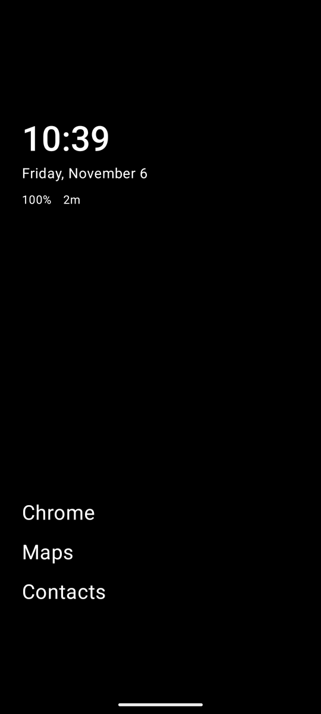
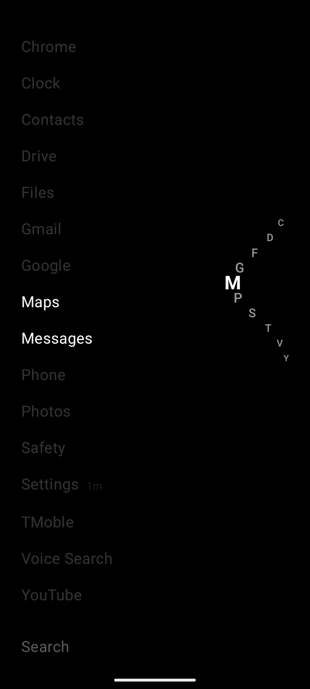
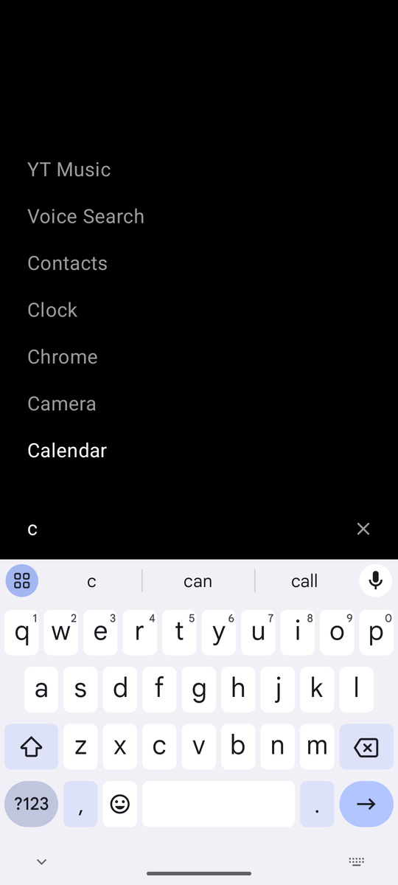

# Minimal Launcher

A text-only Android home screen. The home page shows the time, date, battery, today's screen time and your favourite apps, and nothing else. Swipe up for every app A–Z with the keyboard already open to search, or drag the curved alphabet strip on the right edge to jump through the list.

<p>
  
  
  
</p>

- **Fast:** swipe up and type. When only one app matches, it opens on its own.
- **Thumb-friendly:** an A–Z strip that wraps around your thumb, with a vibration tick per letter.
- **Calm:** no icons, no widgets, no status bar (unless you want it).
- **Screen time:** today's total, and each app's time next to its name.
- **Yours:** favourites in your own order and with your own names, hidden apps, a choice of fonts, text sizes and spacing.
- **Private:** no internet access at all. Nothing leaves your phone.

## Install

Needs Android 8.0 or newer.

1. On your phone, download the `.apk` file from the [latest release](https://github.com/RuizSerra/minimal-launcher/releases/latest).
2. Open it. Android will ask you to let your browser (or Files app) install apps: allow it. If Play Protect warns that it doesn't recognise the developer, choose **Install anyway**.
3. Press Home and pick **Minimal Launcher**, then **Always**. Or go to Settings → Apps → Default apps → Home app.

To update, install the newer `.apk` over the old one; your favourites and settings stay. To go back to your old launcher, change Settings → Apps → Default apps → Home app, or uninstall Minimal Launcher.

## Using it

| Gesture | Does |
|---|---|
| Swipe up | Open the A–Z list of every app, with the keyboard up for search. A short swipe is enough; the page snaps open. (Turn the keyboard part off under Launcher settings → Keyboard on swipe up.) |
| Type | The list turns into search results. As soon as only one app matches, it opens. Otherwise Enter opens the top result, shown in white |
| Scroll the list, or touch the letters | Puts the keyboard away. Tap "Search" at the bottom to bring it back |
| Drag the letters on the right | Jump to a letter: its apps move to the middle of the screen and the rest dim, with a vibration tick at each new letter |
| Swipe down from the top of the list | Back to the home page |
| Swipe down on the home page | Open the notification shade |
| Swipe down from the very top edge | Show the status bar for a few seconds (when it's hidden) |
| Double-tap empty space on the home page | Lock the screen (needs a one-time switch, see below) |
| Long-press an app | Add/remove favourite, rename or reorder favourites, hide, app info, uninstall |
| Long-press empty space on the home page | Launcher settings |
| Tap the clock / date / battery / screen time | Open the clock app / the calendar / battery usage / the Digital Wellbeing dashboard |
| Home (while on the launcher) | Jump straight back to the home page |
| Back | Close the keyboard, then clear the search, then go back to the home page |

The launcher always stays upright, whether or not auto-rotate is on.

### Settings

Long-press empty space on the home page:

- **Favourites:** reorder them. To add one, long-press any app in the list. **Rename** a favourite (say, "Weawow" to "Weather") from its long-press menu; the new name shows on the home page only.
- **Hidden apps:** hidden apps disappear from the list and from search. Unhide them here.
- **Keyboard on swipe up:** open the keyboard as the list opens, or not.
- **Status bar:** hidden by default. While hidden, a swipe down from the top edge shows it for a few seconds; other apps keep theirs.
- **Font:** System default, Inter, Space Grotesk, Manrope, Lora, JetBrains Mono or Condensed.
- **Text size and spacing:** sizes for the clock and date, the favourites and the app list (70% to 200%), and the app list's line spacing (25% to 200%). The screen behind the sheet shows each change as you tap.
- **Screen time access** and **Double-tap to lock:** see below.

### Screen time

Turn on **Usage access** for Minimal Launcher when asked (tap "enable screen time" on the home page). The home page then shows today's total next to the battery, as `12m` or `1h23m`, and every app used for at least a minute shows its own time after its name. Tap the total to open your phone's Digital Wellbeing dashboard.

The numbers are worked out on your phone from Android's app usage records. They're close to Digital Wellbeing's, but won't match exactly. Work-profile apps don't get a time, because Android only shares usage for the personal profile.

### Double-tap to lock

Android only lets an app lock the screen through an accessibility service. (The other route, device admin, would make you type your PIN on every unlock, with no fingerprint or face unlock.) Minimal Launcher includes a tiny service that does nothing but lock: it asks for no accessibility events and can't read your screen.

The first double-tap takes you to Accessibility settings: turn on **Minimal Launcher: double-tap to lock**. Android shows its standard warning for accessibility services.

On Android 13 and newer, the switch may be greyed out as a "restricted setting", because the app wasn't installed from an app store. To allow it:

1. Tap the greyed-out switch once.
2. Go to Settings → Apps → Minimal Launcher → ⋮ (top right) → **Allow restricted settings**.
3. Turn the switch on.

## Privacy

Minimal Launcher has no internet permission, so it can't send anything anywhere. It stores only your favourites, their names, hidden apps and settings, on your phone.

| Permission | Why |
|---|---|
| Usage access (optional, you turn it on) | Screen time. Read on the phone, never stored |
| Accessibility (optional, you turn it on) | Double-tap to lock, nothing else |
| Vibrate | The tick on each letter and on double-tap lock |
| Expand status bar | Swipe down to open the notification shade |
| Request uninstall | Opens Android's own uninstall dialog from an app's menu |
| Set alarm | Lets the clock open your clock app |

## Build from source

Needs JDK 17 and the Android SDK; Android Studio can open the project as-is. With a phone connected (USB debugging on):

```sh
./gradlew installRelease
```

The release build is the one to use day to day: Compose runs noticeably smoother than in debug builds.

Release builds are signed with the key set in `~/.gradle/gradle.properties`:

- `minimalLauncher.storeFile`
- `minimalLauncher.storePassword`
- `minimalLauncher.keyAlias`
- `minimalLauncher.keyPassword`

Without those, they're signed with your debug key. That works fine for your own phone, but it can't update a copy installed from the releases page; uninstall that first.

**Publishing a release:**

1. Raise `versionCode` and `versionName` in `app/build.gradle.kts`.
2. Run `./gradlew assembleRelease`.
3. Attach `app/build/outputs/apk/release/app-release.apk` to a new GitHub release.

**Tuning knobs** (constants at the top of each file):

- `HomePageFling.kt`: `SnapSpring` (how fast the list snaps open).
- `LauncherScreen.kt`: `HomeClockShare`, `HomeBottomShare` and `HomeBlockGap` (home page layout).
- `AlphabetScroller.kt`: the letter strip's spacing and curve.
- `TickHaptics.kt`: vibration strength.

### Code map

```
app/src/main/java/dev/jaime/launcher/
  MainActivity.kt          Home intent handling, status bar, default-launcher prompt
  LauncherViewModel.kt     App list, favourites, hidden apps, screen-time state
  SystemActions.kt         Launching apps and system screens (clock, calendar, settings…)
  LockService.kt           Accessibility service used only for double-tap to lock
  data/AppRepository.kt    Installed apps, with live updates on install/uninstall
  data/ScreenTime.kt       Screen time from usage events, total and per app
  data/Search.kt           Search ranking: prefix, word prefix, substring, initials
  data/LauncherPrefs.kt    Favourites, names, hidden apps and settings (SharedPreferences)
  ui/LauncherScreen.kt     Home page + A–Z list (one list), search, sheets wiring
  ui/HomePageFling.kt      Snaps between the home page and the app list
  ui/AlphabetScroller.kt   The thumb-wrapping A–Z strip
  ui/KeyboardInsets.kt     Where the keyboard's top is (capped while it slides in)
  ui/SearchField.kt        The search row at the bottom of the app list
  ui/Header.kt             Clock, date, battery, screen time
  ui/Sheets.kt             Long-press menus and settings
  ui/Fonts.kt              The font choices (files in assets/fonts)
  ui/TickHaptics.kt        The vibration tick
```

## Licence

Copyright © 2026 Jaime Ruiz Serra. Minimal Launcher is free software under the [GNU General Public License v3.0](LICENSE).

The bundled fonts (Inter, Space Grotesk, Manrope, Lora, JetBrains Mono) are from [Google Fonts](https://fonts.google.com) under the SIL Open Font License 1.1. Their licence texts are in [`app/src/main/assets/licenses`](app/src/main/assets/licenses).
